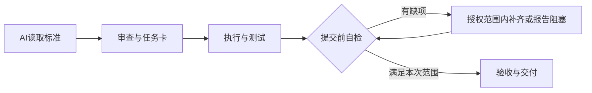

# qixian771-spec · AI 交付统一说明

供账号下各仓库引用的统一标准。目标是让AI在缺少历史聊天时，也能先审查实际实现，补齐执行编排、测试和验收，再按已有授权提交。

**主要读者和执行者都是AI。** AI应直接完成授权内工作；文档提供输入来源、工具动作、成功条件和失败停止路径。用户只处理必要的输入、登录或授权决策，不承担默认的逐步操作。对人保留简短结果与证据摘要。

**统一入口：[AI_DELIVERY_STANDARD.md](AI_DELIVERY_STANDARD.md)**

阻塞时报告部分完成并结束依赖步骤，不无限循环或扩大范围。

| 文件 | 用途 |
|---|---|
| [统一标准](AI_DELIVERY_STANDARD.md) | 完整要求与“发现不足先补全”自检规则 |
| [贡献说明](CONTRIBUTING.md) | GitHub默认贡献指南，指向统一标准 |
| [PR模板](PULL_REQUEST_TEMPLATE.md) | 提交变更时提示核对方案、任务卡、测试和未执行项 |
| [仓库AGENTS引用入口](templates/repository-AGENTS.md) | 合并到具体仓库的AI说明，不覆盖已有内容 |
| [任务卡模板](templates/task-card.md) | 每个任务和里程碑的证据结构 |
| [初始交付记录](docs/initial-delivery.md) | 本次设置的范围、任务卡及验证 |
| [AI执行优先修订](docs/ai-first-delivery.md) | 执行主体、用户介入边界与本次验收 |

## 以后怎么用

给AI这句话即可：

> 开始修改和提交前，请读取 https://github.com/qixian771-spec/.github/blob/main/AI_DELIVERY_STANDARD.md ，按标准自检。缺失项在已授权范围内补全；不能执行的明确列出原因，不把未执行写成通过。最终用内联表格或Mermaid交付。

也可以把引用入口合并进某个仓库的AGENTS.md，让支持该文件的AI在该仓库工作时看到它。本次没有批量修改其他仓库。

## 什么会自动显示，什么不会

GitHub支持公开`.github`仓库中的默认贡献指南和PR模板；账号下目标仓库没有自己的同类文件时可以使用默认文件。目标仓库自带文件优先，而且默认文件不会进入其他仓库的clone或安装包。[GitHub官方说明](https://docs.github.com/en/communities/setting-up-your-project-for-healthy-contributions/creating-a-default-community-health-file)

**AGENTS.md不属于账号级自动继承机制。** 本仓库不保证每个AI自动读取中央正文，不阻止直接上传，不自动启动AI，也不新增CI/分支保护。这里提供统一说明和补全提示，不是强制门禁。
